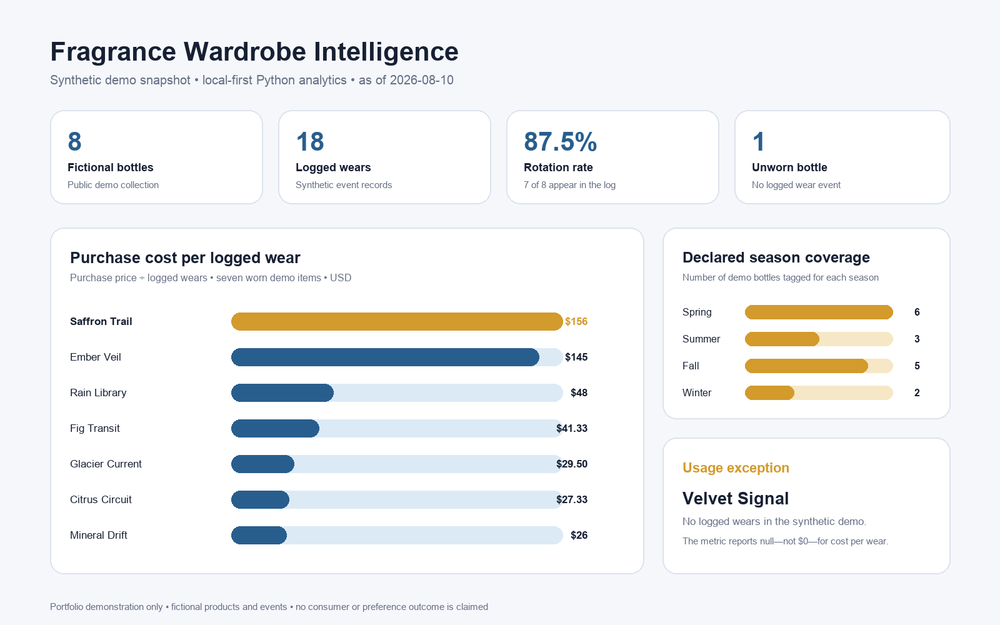

# Fragrance Wardrobe Intelligence

Fragrance Wardrobe Intelligence is a local-first Python project for turning a
personal fragrance collection and wear log into practical, explainable wardrobe
decisions. It measures rotation, cost per logged wear, unused or neglected
bottles, collection coverage, and profile similarity without requiring a cloud
service or a scraped commercial fragrance database.

No cloud account is required. The verified MVP runs with Python's standard
library and the files in this repository.

## Why this project

A fragrance collection is easy to inventory but harder to use intentionally.
Common questions are analytical:

- Which bottles are actually in rotation?
- Which purchases have the highest cost per logged wear?
- What has not been worn recently?
- Does the collection overconcentrate on one family, season, or occasion?
- Which fragrance already in the wardrobe is the closest alternative to a
  selected profile, and why?

The project treats those as transparent data questions rather than relying on a
black-box shopping recommendation.

## What the MVP does

- validates a collection data contract and rejects duplicate or invalid records;
- validates wear-log dates, ratings, sprays, and collection references;
- calculates rotation rate, family/season/occasion coverage, and cost per logged
  wear;
- identifies bottles with no logged wears or no recent wears under a chosen
  threshold;
- ranks similar fragrances already in the wardrobe with an explainable heuristic;
- emits deterministic JSON suitable for a later dashboard or analytics model.

## Demo snapshot



The snapshot is generated from the same public CSV inputs and tested analytical
functions as the CLI. It compares purchase cost per logged wear across the seven
worn fictional items, summarizes declared seasonal coverage, and calls out the
unworn item without converting its missing ratio to zero.

## Public data boundary

The included CSVs are synthetic demonstration data created for this portfolio.
The fictional houses, products, prices, ratings, and wear events do not describe
a real collection or consumer outcome. They are not scraped from Fragrantica or Parfumo.

Use the empty [collection template](data/collection_template.csv) and
[wear-log template](data/wear_log_template.csv) for user-owned data. Do not
commit private purchase, location, account, or health information.

## Run it locally

Requirements: Python 3.9 or later. There are no third-party runtime packages.

```bash
PYTHONPATH=src python3 -m fragrance_intelligence.cli summary \
  --collection data/demo_collection.csv \
  --wear-log data/demo_wear_log.csv \
  --as-of 2026-08-10 \
  --neglect-days 30
```

Find the closest profiles already in the demo wardrobe:

```bash
PYTHONPATH=src python3 -m fragrance_intelligence.cli similar \
  --collection data/demo_collection.csv \
  --target demo-glacier-current \
  --limit 3
```

Run all tests:

```bash
PYTHONDONTWRITEBYTECODE=1 PYTHONPATH=src python3 -m unittest discover -s tests -v
```

Rebuild the optional static visual with Python 3.9+ and Pillow:

```bash
python3 -m pip install -r requirements-visual.txt
python3 scripts/create_visual_summary.py
```

## How similarity works

The explainable heuristic combines note overlap, fragrance family, season and
occasion overlap, longevity, and projection. Every result includes its component
scores and plain-language reasons. It does not predict personal preference,
purchase satisfaction, or fragrance quality.

See [Methods and limitations](METHODS_AND_LIMITATIONS.md) for the weights and
interpretation boundary.

## Project structure

```text
data/                         Synthetic demo data and empty user templates
assets/                       Generated recruiter-facing visual summary
scripts/                      Optional visual renderer
src/fragrance_intelligence/   Validation, analytics, recommender, and CLI
tests/                        Unit, integration, and publication-safety checks
README.md                     Recruiter-facing overview and first run
VISUAL_SUMMARY_DESIGN.md       Chart contract and claim boundary
DATA_MODEL.md                 Field definitions and relationships
DATA_AND_USAGE.md             Provenance, ownership, and safe-use rules
METHODS_AND_LIMITATIONS.md     Metric definitions and honest limitations
```

## What this demonstrates

- a clear, validated tabular data contract;
- referential integrity between collection and event data;
- deterministic Python analytics with no hidden service dependency;
- an inspectable recommendation method instead of an unsupported ML claim;
- privacy and data-rights boundaries designed into the public package;
- a clean foundation for a future DuckDB/dbt analytics layer and visual
  application.

## Current status

This repository contains a tested local MVP published as portfolio proof. It is
not a hosted application or production service. Future work may add user-owned
data, DuckDB and dbt models, automated data-quality reporting, and an interactive
interface after those additions are separately reviewed.
